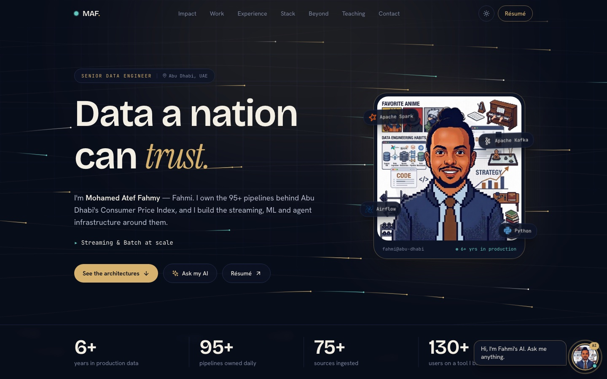
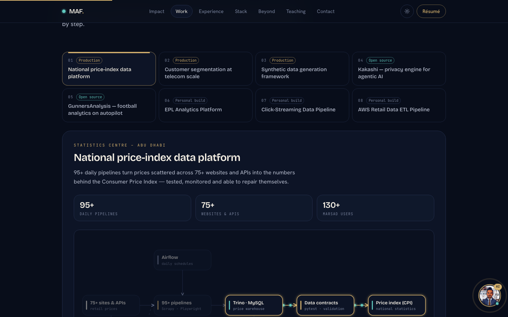

# Mohamed Atef Fahmy — Senior Data Engineer

**Live site: [maf-portfolio-one.vercel.app](https://maf-portfolio-one.vercel.app)**

My portfolio: the systems I run in production, the things I build on the side, and what keeps me human away from the keyboard. Animated architectures you can step through, real numbers, and an AI version of me you can question.



## What's on the page

| Section | What it shows |
|---|---|
| **Hero** | An animated data-stream background that bends around the cursor, rotating roles and headline stats |
| **Skills marquee** | Two rows of tech logos scrolling in opposite directions |
| **Impact** | Count-up achievements, led by a 16h → 2h race bar |
| **Work** | Eight animated architecture diagrams with a step-by-step flow player |
| **Experience** | A timeline whose line draws itself as you scroll |
| **Stack** | Logos orbiting a core in three rings, plus the full skill list |
| **Beyond the pipeline** | A playable piano, an animated football move, a breathing circle, a secret-masking demo, an agent loop and a bookshelf |
| **Teaching & writing** | The bootcamp curriculum, the Arabic Data Engineering roadmap, Medium articles and credentials |
| **Contact** | Email, LinkedIn, GitHub, Medium |
| **AI chat** | A draggable floating avatar that answers questions about me |

### Animated architectures

Pick a system and watch the data move through it. Each diagram plays its own flow, one step at a time, and can be paused or clicked through.



1. National price-index data platform
2. Customer segmentation at telecom scale
3. Synthetic data generation framework
4. [Kakashi](https://github.com/Muhammadatef/kakashi) — privacy engine for agentic AI
5. [GunnersAnalysis](https://github.com/Muhammadatef/gunners-analysis) — football analytics on autopilot
6. [EPL Analytics Platform](https://github.com/Muhammadatef/EPL-Analytics-Platform)
7. [Click-Streaming Data Pipeline](https://github.com/Muhammadatef/Click-Streaming-Data-Pipeline)
8. [AWS Retail Data ETL Pipeline](https://github.com/Muhammadatef/AWS-Retail-Data-ETL-Pipeline)

## Tech stack

- **Framework:** Next.js 14 (App Router), React 18, TypeScript
- **Styling:** Tailwind CSS with CSS-variable design tokens (light and dark themes)
- **Motion:** Framer Motion, Canvas 2D for the hero, SVG for the diagrams
- **Audio:** Web Audio API for the piano (no samples)
- **Icons:** `react-icons` (Simple Icons) and `lucide-react`
- **Hosting:** Vercel, deployed automatically from `main`
- **CI:** GitHub Actions runs a type check and a production build on every push

## Run it locally

```bash
git clone https://github.com/Muhammadatef/MAF-Portfolio.git
cd MAF-Portfolio
npm install
npm run dev
```

Then open http://localhost:3000.

| Command | What it does |
|---|---|
| `npm run dev` | Start the development server |
| `npm run build` | Production build |
| `npm run start` | Serve the production build |
| `npm run type-check` | TypeScript check without building |

## Editing the content

Almost everything on the site, and everything the chatbot says, comes from one file: **`src/data/profile.ts`**.

| To change… | Edit this export |
|---|---|
| Name, links, bio, hobbies | `profile` |
| Hero numbers | `heroStats` |
| Jobs and bullet points | `experience` |
| The animated diagrams | `architectures` |
| Project cards | `projects` |
| Skill groups | `skills` |
| Impact cards | `achievements` |
| Medium articles | `articles` |
| Education and certificates | `education`, `certifications` |
| Bootcamp block | `bootcamp` |

To replace the résumé, overwrite `public/resume.pdf`.

### Adding an architecture diagram

Each entry in `architectures` describes its own diagram:

- **`nodes`** — boxes, placed on a 5 × 3 grid with `x: C[0..4]` and `y: R[0..2]`
- **`edges`** — arrows between node ids (`dashed: true` for control or feedback paths)
- **`steps`** — the flow: each step has a title, a sentence, and the node ids to light up. An edge animates when both of its ends are lit.

Keep node sub-labels to about 22 characters so they fit inside the box.

## The AI chat

The floating avatar answers in two ways:

1. **Built-in answers (default).** Questions are matched by keyword to prepared answers rendered from `profile.ts`. No API key is needed.
2. **Real AI (optional).** Set `ANTHROPIC_API_KEY` in Vercel → Project → Settings → Environment Variables. Questions that match no keyword are then sent to Claude with a prompt built from `profile.ts`.

## Project structure

```
src/
├── app/
│   ├── layout.tsx          fonts, metadata, theme bootstrap
│   ├── page.tsx            renders <Portfolio />
│   ├── globals.css         colour tokens and shared styles
│   └── api/chat/route.ts   optional real-AI endpoint
├── components/
│   ├── site/               one file per section (Hero, Work, Beyond, …)
│   │   ├── ArchDiagram.tsx the animated diagram renderer
│   │   ├── DataStream.tsx  hero canvas
│   │   ├── audio.ts        piano audio engine
│   │   └── logos.tsx       tech logos for the marquee and orbit
│   ├── ai/                 ChatWidget and its prepared answers
│   └── ThemeToggle.tsx
└── data/profile.ts         all content
```

## Design

- **Palette:** midnight navy, ivory and a brass accent, with teal reserved for data in motion. Tokens live at the top of `src/app/globals.css`.
- **Type:** Bricolage Grotesque for headings, Instrument Serif italics for emphasis, Hanken Grotesk for body text, JetBrains Mono for labels.
- **Motion:** animations pause when off-screen and are disabled for visitors who prefer reduced motion.

## Contact

- Email: muhamedfahmy7474@gmail.com
- LinkedIn: [mohamed-atef-fahmy-khalil](https://www.linkedin.com/in/mohamed-atef-fahmy-khalil/)
- Medium: [@muhamedfahmy7474](https://medium.com/@muhamedfahmy7474)
